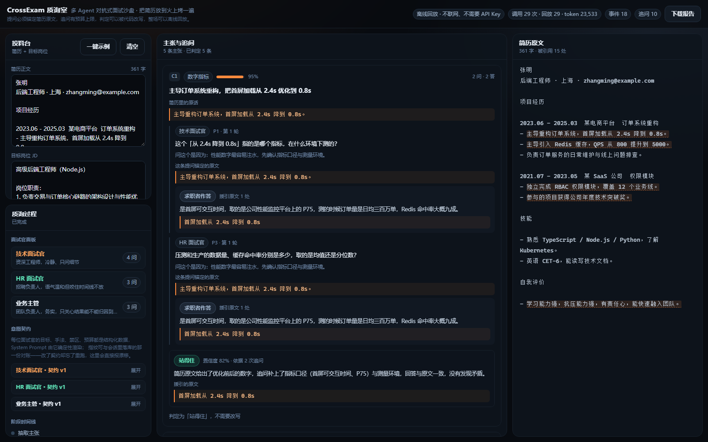

# CrossExam 质询室

> **把你准备好的简历交给一整间面试官，先替你审一遍。**
> 多 Agent 对抗式面试沙盘 —— 不是让 AI 帮你写简历，是让一群 AI 面试官告诉你简历里哪句话站不住。

参加：**全国高校 Vibe Coding 开发挑战赛 · AI创新应用挑战赛**（赛道 id 10039）。



---

## 这是什么

你投出去的每一份简历，面试官都会挑着问。真正让人翻车的不是排版，是
**简历里写了但你其实答不上来的那句话**。

CrossExam 把这件事提前：喂入简历 + 目标岗位 JD，系统抽出简历里一条条**可被追问的主张**，
按主张类型组成一间面试官（技术 / HR / 业务主管 / 压力面试官 / 领域专家），并发向你追问。
你答完，它给每条主张一个结论，并**反推回简历**告诉你该改哪一句、怎么改。

| 阶段 | 做什么 |
| --- | --- |
| 投料 | 简历 + 目标岗位 JD |
| 拆解 | 抽出「可被追问的主张」，每条锚定简历原文 |
| 组庭 | 依据主张与 JD 生成面试官阵容（意图契约可见） |
| 对抗 | 多面试官并发追问，你回答，它继续追问 |
| 判定 | 每条主张：站得住 / 表述过度 / 证据缺失 / 与原文矛盾 / 无法回答 |
| 反推 | 定位到原文片段的简历修改建议 |

---

## 10 分钟极速复现（评审请从这里开始）

**前置条件**：Node.js ≥ 22.5（`node -v` 看一眼）。不需要 API Key，不需要数据库，不需要 Docker，
不需要管理员权限，全仓库**没有任何需要本地编译的原生依赖**。

```bash
git clone <仓库地址> crossexam
cd crossexam
npm install
npm run preview        # 构建前端 + 起服务，默认 http://127.0.0.1:8787
```

然后：打开 `http://127.0.0.1:8787` → 点 **一键示例** → 可切「慢放」看流式过程 → 点 **开始质询**。
3 轮、5 条主张、10 次追问、5 条判定、4 条改写建议会依次出现在界面上，
最后点右上角 **下载报告** 可以拿到这次质询的 Markdown 报告。

### 为什么不需要 API Key

默认运行在`回放`模式：仓库里带着 29 盘已录制的模型响应（`fixtures/llm/*.json`），
按**提示词指纹**寻址。所以任何一台机器、任何一个时间点，跑出来的都是同一场质询——
这是「过程可复现」的技术底座，也是评委不用配任何东西就能验收的原因。
卡带里的一部分是合成演示数据（`model` 字段写着 `scripted-demo`），不是真实模型输出；
详见 [fixtures/README.md](fixtures/README.md)。

### 复现耗时（实测，不是估算）

```bash
npm run repro          # 干净目录复现预演：clone → install → 门禁 → 起服 → 跑完一场，逐步计时
```

在干净的临时目录里（不借用开发目录里任何已存在的东西）实测：

| 步骤 | 耗时 |
| --- | --- |
| git clone | 7.6 s |
| npm install（116 个包，无原生编译） | 15.5 s |
| npm run verify（类型检查 + 测试 + 冒烟 + 构建） | 13.8 s |
| 起服务 + 跑完一场质询 + 下载报告 | 0.5 s |
| **合计** | **约 40 秒** |

想联网跑真实模型：

```bash
cp .env.example .env   # 填 LLM_BASE_URL / LLM_API_KEY / LLM_MODEL（任何 OpenAI 兼容端点）
CROSSEXAM_MODE=live npm run preview
```

想把自己的对话录成新卡带（例如换一个模型）：`CROSSEXAM_MODE=record npm run preview`，跑一遍后卡带落到 `fixtures/llm/`。

面试官人数默认 3 位（技术 / HR / 业务主管）；想加压力面试官或领域专家，用 `?panel=tech,hr,stress` 点名，
`.env` 里的 `PANEL_SIZE` 是**同时上场的上限**（1–6，只截断不补齐），启动横幅会打出实际生效的上限。

---

## 命令表

| 命令 | 作用 |
| --- | --- |
| `npm run preview` | 构建前端并起一个端口的完整产品 |
| `npm run dev` | 前后端热更新（两个进程，开发用） |
| `npm run verify` | **提交门禁**：类型检查 + 测试 + 真进程冒烟 + 构建 |
| `npm run smoke` | 真起一个服务进程打接口（含 SSE 收尾检查） |
| `npm run shots` | 真浏览器（Edge/Chrome + CDP）截 10 张图，控制台有报错即失败 |
| `npm run seed:demo` | 重新合成 29 盘离线演示卡带（改了提示词就必须重跑） |
| `npm run repro` | 干净目录复现预演，逐步计时并与 10 分钟上限比对 |
| `npm run export:prompt` | 导出 AI 协同的 Prompt 链快照到 `docs/prompt-chain/` |

---

## 复现遇到问题怎么办

| 现象 | 处理 |
| --- | --- |
| 端口被占 | `CROSSEXAM_PORT=8899 npm run preview` |
| 想换数据库位置 / 清空重来 | `CROSSEXAM_DB=./data/other.db`；删掉 `data/` 就是全新状态 |
| 想换卡带目录 | `CROSSEXAM_FIXTURES=/path/to/llm` |
| 没装 Chrome/Edge | 只有 `npm run shots` 需要浏览器，其余命令都不需要 |
| 界面 404 / 空白 | 先跑 `npm run build`：服务端托管的是构建产物，不是源码 |
| 提示「回放模式找不到这一条记录」 | 说明提示词变了而卡带没更新：跑 `npm run seed:demo` 或用 `CROSSEXAM_MODE=record` 重录 |

---

## 四个技术支点

| 支点 | 一句话 | 为什么不是装饰 |
| --- | --- | --- |
| **证据锚定** | 每条提问都必须携带简历原文的字符区间 | 提问没有锚点就前端拒显，从设计上排除幻觉式提问 |
| **追问预算** | 每主张轮数 / 每人额度 / 全场总量都在代码里记账 | prompt 里写「最多问 3 次」模型可以不听；记账闸门让死循环不成立 |
| **意图契约** | 每个 Agent 的人设、目标、手法、禁区、预算是结构化 JSON | 可解释、可版本化、可 diff，界面能摊开看并与运行时指纹对账 |
| **可复现回放** | 每次模型调用按提示词指纹落盘成卡带 | 无 Key 也能离线跑通全流程，且同一输入永远同一结果 |

想细看：界面左栏「意图契约」可以直接展开每位面试官的契约与他实际拿到的 System Prompt。

---

## 架构

```
crossexam/
├─ packages/shared/     确定性内核：领域模型、锚定、切分、预算、契约、zod 收敛（纯函数，可单测）
├─ packages/server/     Hono + SSE 服务端：五阶段流水线、LLM 适配层（live/record/replay）、node:sqlite 存储
├─ packages/web/        Vite + React 三栏界面：投料台 / 质询舞台 / 简历原文联动高亮
├─ tools/dsh-export/    把 AI 协同会话导出成 Prompt 链快照（提交物 #2 的自动化来源）
├─ tools/smoke/         真进程冒烟
├─ tools/ui-shots/      真浏览器截图（兼作界面控制台门禁）
├─ tools/repro/         干净目录复现预演
├─ fixtures/llm/        模型响应卡带（离线回放的数据）
└─ docs/                ADR、Prompt 链快照、界面截图
```

技术栈：Node 24 + TypeScript（**服务端零构建**，Node 原生剥离类型直接跑 `.ts`，见 ADR-0001）、
Hono + `@hono/node-server`（SSE 直播）、`node:sqlite`（Node 内置，零原生依赖）、
Vite + React 19 + Tailwind v4、zod（模型输出先过 schema 再入库）、vitest。

---

## 项目文档

| 文档 | 内容 |
| --- | --- |
| [task_plan.md](task_plan.md) | 目标、约束、阶段计划、决策记录、错误记录 |
| [findings.md](findings.md) | 调研发现与踩坑（每条都有教训） |
| [progress.md](progress.md) | 逐次会话的开发日志 |
| [AGENTS.md](AGENTS.md) | 工程约定（提交粒度、安全边界、门禁） |
| [docs/adr/](docs/adr/) | 架构决策记录 |
| [docs/prompt-chain/](docs/prompt-chain/) | AI 协同的 Prompt 链快照（自动导出） |
| [docs/screenshots/](docs/screenshots/) | 界面截图（由 `npm run shots` 生成，不是手点的） |

## 许可

MIT。
