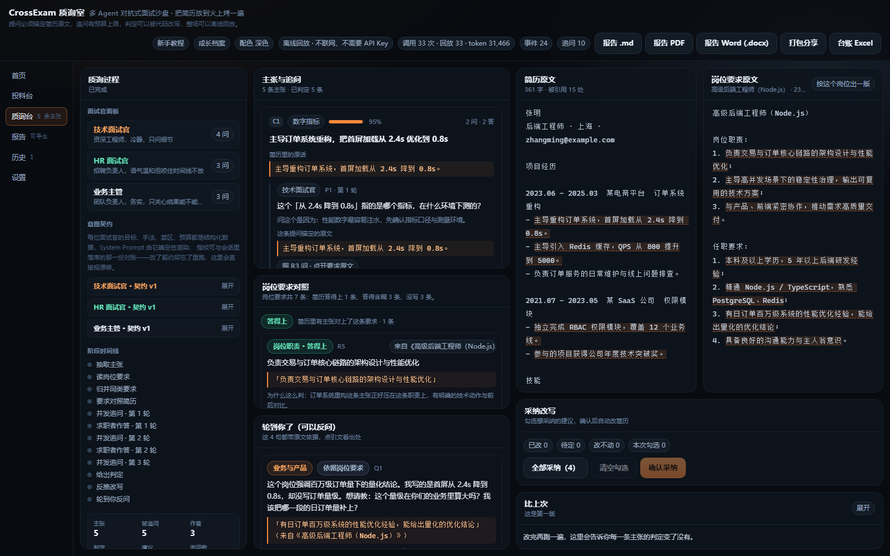

# CrossExam 质询室

> **把你准备好的简历交给一整间面试官，先替你审一遍。**
> 多 Agent 对抗式面试沙盘 —— 不是让 AI 帮你写简历，是让一群 AI 面试官告诉你简历里哪句话站不住。

参加：**全国高校 Vibe Coding 开发挑战赛 · AI创新应用挑战赛**（赛道 id 10039）。



---

## 这是什么

你投出去的每一份简历，面试官都会挑着问。真正让人翻车的不是排版，是
**简历里写了但你其实答不上来的那句话**。

CrossExam 把这件事提前：喂入简历 + 目标岗位 JD，系统抽出简历里一条条**可被追问的主张**，
按主张类型组成一间面试官（技术 / HR / 业务主管 / 压力面试官 / 领域专家），并发向你追问。
你答完，它给每条主张一个结论，并**反推回简历**告诉你该改哪一句、怎么改。

| 阶段 | 做什么 |
| --- | --- |
| 选料 | **岗位模板库**：12 个行业 × 3 个岗位，点一下把岗位名、JD 与示例简历一起填好，并自动装好这位面试官——不懂这个行业也能十秒开工（浏览模板不写库，同一个模板点两次是复用不是新建） |
| 投料 | 简历 + 目标岗位 JD（**可以贴 1–8 份，也可以只贴一份或留空**；也能**从文件导入**：选一份 PDF / Word / 文本，解析出来的正文直接填进输入框，上传的字节不落盘） |
| 拆解 | 抽出「可被追问的主张」，每条锚定简历原文 |
| 审阅 | **岗位要求对照**：贴了 JD 就先把它读成一张要求清单（逐份抽要求 → 跨份归并 → 与你的主张逐条对照），分成「答得上 / 答得含糊 / 简历里没写」三组；前两组会被拿去追问，一条追问同时挂 JD 原文片段与简历片段**两处锚点**，点任一处右栏就聚焦到那一段 |
| 组庭 | 五位预设面试官（技术 / HR / 业务主管 / 压力 / 领域专家），也可以在**面试官工作室**里自己配一位：一句话描述 → 补成意图契约，没有 API Key 就用本地规则生成；契约、指纹与渲染出的 System Prompt 都能摊开看 |
| 对抗 | 多面试官并发追问，你回答，它继续追问 |
| 判定 | 每条主张：站得住 / 表述过度 / 证据缺失 / 与原文矛盾 / 无法回答，并写明「为什么这样判」 |
| 反推 | 定位到原文片段的简历修改建议 |
| 短板 | 同一批判定换个角度：按主张类别聚合，先排欠得最多的那一类，再列出最该补的 3 处，点一下跳回简历原文 |
| 强度 | **追问强度**三档：温和 / 常规 / 挑刺。换的是预算（每主张 2 / 3 / 4 轮、全场 40 / 60 / 80 次）不是人设，档位随会话留档 |
| 风格 | **改写风格**三档：保守（只做减法）/ 常规 / 敢改（整句重写）。只调措辞收敛程度，三条红线不动：不加简历里没有的数字、不把参与写成主导、改前原文必须锚得回原文 |
| 补证据 | 任何一条主张上可以补一句真话当作新证据；采纳时它作为新的一行进简历，原文一个字不动 |
| 反问 | 跑完给你几句能反问 HR 的话，每句都必须锚回简历原话或 JD 原文，锚不回的当场丢弃；回答明确标注是沙盘模拟 |
| 改稿 | 勾选想采纳的建议 → **确认后自动改简历**，右栏直接换成改完的版本；改动段标绿，改不动的（引文在原简历里锚不住）会说明理由。点「并排看改动」还能逐条对照改前改后，并看到它们落在简历的什么位置 |
| 带走 | 报告三种形态：Markdown / 可打印 HTML（另存为 PDF）/ Word；改完的简历另外三种：`.txt` / 导出 PDF / 导出 Word |
| 模式 | 页面里**逐场**选运行模式：离线回放（默认，不联网）/ 联网直连 / 联网录制；模型名可下拉可手填，没配好就直接告诉你缺哪个环境变量 |
| 上手 | 第一次打开自动弹一次新手教程：四步用起来、三种模式对照、隐私口径、常见问题 |
| 变体 | 深色 / 浅色两套配色，头部一键切换并记住选择（浅色给白天与投影用） |

---

## 10 分钟极速复现（评审请从这里开始）

**前置条件**：Node.js ≥ 22.5（`node -v` 看一眼）。不需要 API Key，不需要数据库，不需要 Docker，
不需要管理员权限，全仓库**没有任何需要本地编译的原生依赖**。

### 方式一：不用命令行（给完全没用过命令行的人）

1. 打开 https://nodejs.org/zh-cn/download ，下载写着 **LTS** 的那个安装包，一路「下一步」装完。
2. 把仓库下载下来（右上角 **Code → Download ZIP**，或 `git clone`），解压到一个**路径里没有中文和空格**的目录。
3. **Windows 双击 `启动.cmd`**（macOS / Linux 用 `./启动.sh`）。
   第一次它会自己装依赖、自己构建界面，然后把浏览器打开——中途关掉黑窗口就是停止。
4. 想以后从桌面直接进：双击 **`装个快捷方式.cmd`**，桌面会出现「质询室 CrossExam」。

启动器会检查 Node 版本，太旧就直说该装哪个（不猜、不替你装）；第二次双击只花两秒，
已经有一个在跑时会直接把浏览器叫到前面来。判断逻辑是纯函数，有 12 条测试守着（`tools/launcher`）。

### 方式二：命令行（开发与评审）

```bash
git clone <仓库地址> crossexam
cd crossexam
npm install
npm run preview        # 构建前端 + 起服务，默认 http://127.0.0.1:8787
# 或者：npm run launch  —— 与双击 启动.cmd 等价，已装好的东西会自动跳过
```

然后：打开 `http://127.0.0.1:8787` → 点 **一键示例** → 可切「慢放」看流式过程 → 点 **开始质询**。
3 轮、5 条主张、10 次追问、5 条判定、4 条改写建议、7 条岗位要求对照、4 句可以反问的话会依次出现在界面上，
最后点右上角 **报告 .md / 报告 PDF / 报告 Word** 可以把它带走：Markdown 便于携带，PDF 走浏览器「另存为」（服务端出的是可打印 HTML，不押注你机器上装了什么），Word 可直接接着改。

### 为什么不需要 API Key

默认运行在`回放`模式：仓库里带着 149 盘已录制的模型响应（`fixtures/llm/*.json`），
按**提示词指纹**寻址。所以任何一台机器、任何一个时间点，跑出来的都是同一场质询——
这是「过程可复现」的技术底座，也是评委不用配任何东西就能验收的原因。
卡带里的一部分是合成演示数据（`model` 字段写着 `scripted-demo`），不是真实模型输出；
详见 [fixtures/README.md](fixtures/README.md)。

### 复现耗时（实测，不是估算）

```bash
npm run repro          # 干净目录复现预演：clone → install → 门禁 → 起服 → 跑完一场，逐步计时
```

在干净的临时目录里（不借用开发目录里任何已存在的东西）实测：

| 步骤 | 耗时 |
| --- | --- |
| git clone | 24.6 s |
| npm install（117 个包，无原生编译） | 38.8 s |
| npm run verify（类型检查 + 测试 + 冒烟 + 构建） | 48.4 s |
| 起服务 + 跑完一场质询 + 下载报告 | 1.2 s |
| **合计** | **120.8 秒** |

同一台机器上多次实测落在 34–121 秒之间：磁盘缓存冷热（`clone` 从 2.8 s 到 24.6 s 都出现过）与机器当时在不在忙
都会影响，所以这张表记的是最近一次完整预演的实测值。上限是 600 秒，最慢的一次也还有 5 倍余量。

想联网跑真实模型：**在页面里把「运行模式」切到「联网直连」即可**（不必重启服务）。
也可以先把下面这行写进 `.env`，页面会读到并允许在联网模式间切换：

```bash
cp .env.example .env   # 填 LLM_BASE_URL / LLM_API_KEY / LLM_MODEL（任何 OpenAI 兼容端点）
```

想把自己这一场录成新卡带（例如换一个模型）：在页面里切到**联网录制**跑一遍即可，卡带落到 `fixtures/llm/`；
命令行等价写法是 `CROSSEXAM_MODE=record npm run preview`。录制的卡带按**提示词指纹**寻址，所以改过提示词就必须重录。

面试官人数默认 3 位（技术 / HR / 业务主管）；想加压力面试官或领域专家，用 `?panel=tech,hr,stress` 点名，
`.env` 里的 `PANEL_SIZE` 是**同时上场的上限**（1–6，只截断不补齐），启动横幅会打出实际生效的上限。

---

## 命令表

| 命令 | 作用 |
| --- | --- |
| `npm run launch` | 零门槛启动器：查 Node → 缺什么装什么 → 起服务 → 开浏览器（与双击 `启动.cmd` 等价） |
| `npm run preview` | 构建前端并起一个端口的完整产品 |
| `npm run dev` | 前后端热更新（两个进程，开发用） |
| `npm run verify` | **提交门禁**：类型检查 + 测试 + 真进程冒烟 + 构建 |
| `npm run smoke` | 真起一个服务进程打接口（含 SSE 收尾检查） |
| `npm run shots` | 真浏览器（Edge/Chrome + CDP）截 24 张图，控制台有报错即失败 |
| `npm run e2e:ui` | 真浏览器把每个功能点一遍（132 项断言 + 零控制台报错），红了退出码 1 |
| `npm run seed:demo` | 重新合成 149 盘离线演示卡带（改了提示词就必须重跑） |
| `npm run repro` | 干净目录复现预演，逐步计时并与 10 分钟上限比对 |
| `npm run export:prompt` | 导出 AI 协同的 Prompt 链快照到 `docs/prompt-chain/` |
| `npm run docs:pdf` | 从 `docs/tech/*.md` 重新生成技术文档 PDF（超过 30 页直接失败） |
| `npm run docs:html` | 只渲染 HTML（排查排版用，不调浏览器） |

---

## 复现遇到问题怎么办

| 现象 | 处理 |
| --- | --- |
| 双击 `启动.cmd` 窗口一闪就没 | 说明它中途失败了：在黑窗口里跑 `npm run launch` 能看到完整报错；最常见的是 Node 没装或版本低于 22.5 |
| 解压后双击没反应 / 报路径错误 | 目录路径里有中文或空格。挪到 `D:\crossexam` 这类纯英文路径再试 |
| 桌面没有出现「质询室 CrossExam」 | 双击 `装个快捷方式.cmd` 重试一次；它会打印建到了哪个路径，建失败会说原因 |
| 端口被占 | `CROSSEXAM_PORT=8899 npm run preview`（启动器同样认这个变量） |
| 想换数据库位置 / 清空重来 | `CROSSEXAM_DB=./data/other.db`；删掉 `data/` 就是全新状态 |
| 想换卡带目录 | `CROSSEXAM_FIXTURES=/path/to/llm` |
| 没装 Chrome/Edge | 只有 `npm run shots` 与 `npm run e2e:ui` 需要浏览器，其余命令都不需要 |
| 界面 404 / 空白 | 先跑 `npm run build`：服务端托管的是构建产物，不是源码 |
| 提示「回放模式找不到这一条记录」 | 说明提示词变了而卡带没更新：跑 `npm run seed:demo` 或用 `CROSSEXAM_MODE=record` 重录 |

---

## 四个技术支点

| 支点 | 一句话 | 为什么不是装饰 |
| --- | --- | --- |
| **证据锚定** | 每条提问都必须携带简历原文的字符区间 | 提问没有锚点就前端拒显，从设计上排除幻觉式提问 |
| **追问预算** | 每主张轮数 / 每人额度 / 全场总量都在代码里记账 | prompt 里写「最多问 3 次」模型可以不听；记账闸门让死循环不成立 |
| **意图契约** | 每个 Agent 的人设、目标、手法、禁区、预算是结构化 JSON | 可解释、可版本化、可 diff，界面能摊开看并与运行时指纹对账 |
| **可复现回放** | 每次模型调用按提示词指纹落盘成卡带 | 无 Key 也能离线跑通全流程，且同一输入永远同一结果 |

想细看：界面左栏「意图契约」可以直接展开每位面试官的契约与他实际拿到的 System Prompt。

---

## 架构

```
crossexam/
├─ packages/shared/     确定性内核：领域模型、锚定、切分、预算、契约、zod 收敛（纯函数，可单测）
├─ packages/server/     Hono + SSE 服务端：九阶段流水线（五个核心阶段 + 读 JD 三次 + 收尾一次反问你）、LLM 适配层（live/record/replay）、node:sqlite 存储
├─ packages/web/        Vite + React 五栏界面：投料台 / 质询舞台 / 岗位要求对照 / 简历原文与岗位要求原文分屏联动高亮
├─ tools/dsh-export/    把 AI 协同会话导出成 Prompt 链快照（提交物 #2 的自动化来源）
├─ tools/smoke/         真进程冒烟
├─ tools/ui-shots/      真浏览器截图（兼作界面控制台门禁）
├─ tools/repro/         干净目录复现预演
├─ fixtures/llm/        模型响应卡带（离线回放的数据）
└─ docs/                ADR、Prompt 链快照、界面截图、技术文档源与 PDF、视频脚本
```

技术栈：Node 24 + TypeScript（**服务端零构建**，Node 原生剥离类型直接跑 `.ts`，见 ADR-0001）、
Hono + `@hono/node-server`（SSE 直播）、`node:sqlite`（Node 内置，零原生依赖）、
Vite + React 19 + Tailwind v4、zod（模型输出先过 schema 再入库）、vitest。

---

## 项目文档

| 文档 | 内容 |
| --- | --- |
| [task_plan.md](task_plan.md) | 目标、约束、阶段计划、决策记录、错误记录 |
| [findings.md](findings.md) | 调研发现与踩坑（每条都有教训） |
| [progress.md](progress.md) | 逐次会话的开发日志 |
| [AGENTS.md](AGENTS.md) | 工程约定（提交粒度、安全边界、门禁） |
| [docs/adr/](docs/adr/) | 架构决策记录 |
| [docs/prompt-chain/](docs/prompt-chain/) | AI 协同的 Prompt 链快照（自动导出） |
| [docs/screenshots/](docs/screenshots/) | 界面截图（由 `npm run shots` 生成，不是手点的） |
| [docs/CrossExam-技术文档.pdf](docs/CrossExam-技术文档.pdf) | 技术文档 PDF（≤ 30 页，由 `npm run docs:pdf` 生成） |
| [docs/tech/](docs/tech/) | 技术文档的 Markdown 源（六章 + 封面） |
| [docs/video/script.md](docs/video/script.md) | 演示视频脚本（分镜 + AI 协同段落 + 录制核对表） |
| [docs/release-checklist.md](docs/release-checklist.md) | 发布清单（五项提交物逐项核对，含只有本人能决定的事项） |
| [docs/feature-candidates.md](docs/feature-candidates.md) | 候选功能清单（还没做的按性价比排序，每项写明工时与判断） |

## 许可

MIT。